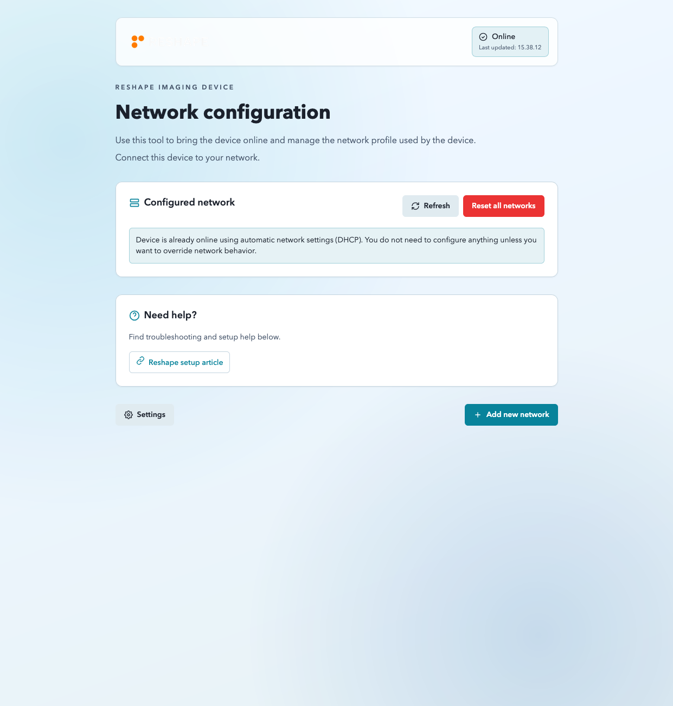
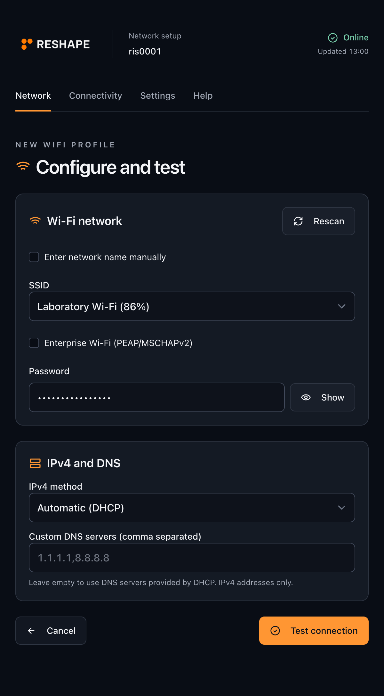

# reshape-netsetup

Network setup for Reshape devices. Join the device's setup Wi-Fi to configure
Wi-Fi or Ethernet through a local captive portal, without needing internet access.

Runs on 64-bit Debian/Raspberry Pi OS 12+ with NetworkManager. The Rust binary
includes the web interface.

  
  

## Features

- Configure Wi-Fi and Ethernet with DHCP or static IP and DNS settings.
- Test a connection before saving it, with separate results for local network,
  gateway, internet, and configurable groups of service endpoints.
- Restore the previous connection after a test so you can rejoin setup Wi-Fi
  and review the result.
- Roll back failed network changes using NetworkManager checkpoints.
- Manage saved networks and manually enable or disable setup Wi-Fi.

## When does setup Wi-Fi appear?

**At boot, setup Wi-Fi opens if the device cannot get online.**

1. Existing networks get **90 seconds from boot** to provide internet access.
2. If internet is detected during that window, the AP stays off.
3. Otherwise, the device starts its setup AP after the window expires.

After the boot window, setup Wi-Fi also opens if **no Wi-Fi client or Ethernet
profiles remain in NetworkManager**, confirmed by two checks about eight seconds
apart. The device's own AP profile does not count. Saved wired profiles count even
when disconnected or waiting for DHCP; delete those too to fully clear setup.

**Losing internet later does not start the AP while client profiles remain**,
however long the outage lasts. Connection tests and saves pause AP automation.
Within a service session, turning the AP off manually suppresses this fallback
until client configuration is added and removed again.
Restarting the service does not repeat the boot decision. Starting the service
for the first time after the boot window skips the boot check; the empty-profile
fallback still applies.

You can still enable the AP manually. Resetting network settings and restoring
setup Wi-Fi after a connection test can also bring it back.

Join the AP and open the captive portal, or visit <http://10.42.0.1/>.
Its name defaults to the device hostname; its password is set during installation.
The boot window is configurable with `AP_BOOT_GRACE_SECONDS`.

## Installation

See [INSTALL.md](INSTALL.md) for release bundles, minimal configuration, and upgrades.

Licensed under [Apache-2.0](LICENSE).
